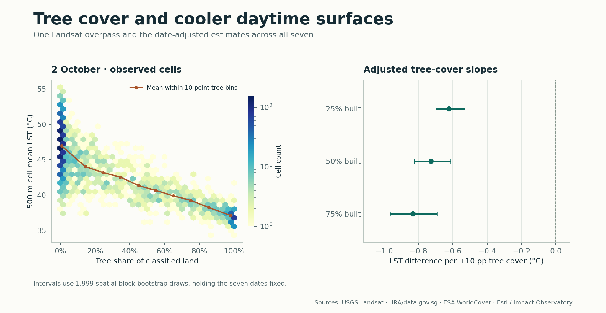

# Tree cover and daytime land surface temperature in Singapore

This study uses seven clear-sky Landsat 8/9 overpasses in 2025 and eight validation overpasses in 2023–24 to ask whether parts of Singapore with more tree cover had cooler daytime surfaces, and whether the association varied with built-area cover. It combines 10 m land-cover classifications and Landsat surface-temperature measurements on a 500 m grid.

## Stage 7 image and temperature review of the wider-only pairs

Seven of the nine wider-only observations came from one Bukit Merah pair. Its higher-tree cell was **1.59–4.56 °C warmer** across the seven original Landsat overpasses. Across the nine observations, two had sufficient coverage at both endpoints after the 4 K and cloud-distance screen. After removing both contributing blocks, the two matching rules retained the same 28 records and gave **−0.50 °C per five points** [−1.01, +0.45]. This moves the primary estimate by **+0.52 °C** and the wider estimate by **−0.59 °C**.

[Stage 7 methods and findings](docs/INFLUENTIAL_PAIR_AUDIT_RESULTS.md) · [Original Landsat images](results/influential_pair_audit/figures/landsat_original_pairs.png) · [Quality and block omission](results/influential_pair_audit/figures/temperature_quality_and_omission.png)

## Stage 6 tree cover replacing rangeland in dense built areas

Among cells with at least 90% built cover, no eligible cell-date had 10% mapped rangeland. The five-point rule found 750 possible donors. After matching cover shares, 700 had a same-date partner, 50 had one within 2 km, and 32 had one in the same 4 km block. The pooled ≥80% built analysis used 36 pairs in nine blocks. The matched five-point daytime LST contrast was **−1.02 °C** [−1.85, +0.16]. Wider balance tolerances gave **+0.09 °C** [−0.65, +0.60] in the matched analysis and **−1.08 °C** [−1.99, +1.03] after adjustment. The primary pairs cover built shares of 87.88–94.64%.

[Stage 6 methods and findings](docs/DENSE_TREE_SWAP_RESULTS.md) · [Rangeland and pairing support](results/dense_tree_swap/figures/rangeland_and_pair_support.png) · [Dense-area pair map](results/dense_tree_swap/figures/dense_pair_map.png) · [Five-point estimates](results/dense_tree_swap/figures/five_point_estimates.png)

## Stage 5 tree cover replacing grass and shrub cover

Fifteen clear-sky overpasses supplied 216 nearby pairs across 94 distinct 500 m cells. At comparable built cover, a ten-percentage-point shift from mapped grass and shrub cover to tree cover corresponded to **0.355 °C lower daytime surface temperature**. Adding distance to the coast and large inland water on the same pairs gave **0.379 °C lower**, with a 95% spatial-bootstrap interval of **−1.22 to +0.18 °C**. The paired change between models was **−0.024 °C** [−0.37, +0.20]. The median built share in the paired cell-years was 4.0%, reflecting where the land-cover exchange had local support.

[Stage 5 methods and findings](docs/GRASS_TREE_SUBSTITUTION_RESULTS.md) · [Comparable grid map](results/grass_tree_substitution/figures/comparable_grids.png) · [Estimates and sensitivity figure](results/grass_tree_substitution/figures/temperature_contrasts.png)

## Stage 4 land-cover and comparison-support audit

The original Esri built-share stability rule alone reduced the number of blocks supporting the 65% built reference from **13 to 1**. The full stability rule reduced it to zero. Original Sentinel-2 images showed coherent surface changes in seven of 19 reviewed cells. Reconstructing Dynamic World from the released model provided a second classification. With all clear labels and a shared optical footprint, Esri and Dynamic World both supported the two-band contrast on **two** common blocks. The 65% reference lost support under stable shares in each product.

[Stage 4 method and findings](docs/COVER_SUPPORT_AUDIT_RESULTS.md) · [Original images](results/cover_support_audit/figures/original_scene_examples.png) · [Comparison counts](results/cover_support_audit/figures/support_counts.png)

## Stage 3 validation on additional overpasses

The 30 remaining 2025 Tier 1 scenes supplied zero qualifying dates under the original scene screen. Six scenes from 2023 and two from 2024 qualified, covering all four calendar periods. On these eight dates, ten more percentage points of tree cover was associated with **0.49 °C lower daytime surface temperature** within a date and 4 km area [−0.57, −0.43]. The original estimate was 0.48 °C lower. The pooled 85%-minus-65% built-cover difference was **+0.50 °C** [−0.21, +1.16], and the point estimate was **−0.18 °C** on the subset of shared block-dates. Both approximate 95% intervals for the built-cover difference span zero.

[Validation methods and results](docs/OVERPASS_VALIDATION_RESULTS.md) · [Candidate coverage](results/overpass_validation/figures/candidate_coverage.png) · [Comparison figure](results/overpass_validation/figures/validation_estimates.png) · [Reproduction guide](docs/REPRODUCE.md#stage-3-validation-on-additional-overpasses)

## Stage 2 variation with built cover

For the same comparison from 2.5% to 12.5% tree cover, the fitted daytime land surface temperature was **1.46 °C lower at 65% built cover** and **0.97 °C lower at 85%**. The higher-minus-lower difference of **+0.49 °C** had an approximate 95% spatial-bootstrap interval of **−0.09 to +1.21 °C**. The point difference reversed sign when both built bands were restricted to the same block-dates. Six 4 km blocks supported both bands on the same date, and only one did so under the stricter nearby-pair rules.

[Stage 2 methods and results](docs/BUILT_COVER_RESULTS.md) · [Frozen comparison protocol](docs/BUILT_COVER_PROTOCOL.md) · [Joint cover distribution](results/built_cover_moderation/design/joint_support.png) · [Contrast and sensitivity figure](results/built_cover_moderation/figures/contrast_estimates.png)

## Stage 1 local comparisons

Within the same Landsat date and 4 km area, a 10-percentage-point higher tree share was associated with **0.48 °C lower daytime land surface temperature** after accounting for built cover and land share. The approximate 95% spatial-bootstrap interval was **0.40–0.57 °C lower**. The regression used 14,641 cell-dates and 2,486 distinct 500 m cells. In 431 disjoint same-date pairs with comparable built and land shares, the estimated difference was 0.74 °C lower, with an interval of 0.42–1.06 °C lower. The paired cells cover a smaller and greener part of Singapore's usable sample.

[Stage 1 results and diagnostics](docs/LOCAL_COMPARISON_RESULTS.md) · [Frozen pairing protocol](docs/LOCAL_COMPARISON_PROTOCOL.md) · [Map of comparable cells](results/local_comparison/design/comparable_grid_cells.png)

## Baseline results

The main analysis uses **14,678 observations across 2,491 grid cells**. At 50% built-area cover, cells with 10 percentage points more tree cover had **0.73 °C lower daytime land surface temperature** on average within an overpass, with an approximate 95% spatial-bootstrap interval of **0.61 to 0.82 °C lower**.

The estimated tree association was stronger at higher built-area shares in the linear interaction model. Adding separate quadratic terms for tree and built-area cover made the interaction less certain. The interval included zero in the quadratic model. The negative tree association held across the dates and coverage, mask, grid and model checks.



The observations describe land surface temperature around **11:16 a.m. Singapore time** on the seven selected dates. The estimates are observational and do not establish causal cooling. They describe satellite surface temperature for the sampled overpasses. Air temperature, night conditions, and individual heat exposure require distinct measurements.

## How the sample was built

1. The feasibility study tested 2025 Terra MODIS coverage against existing annual rules. Even assuming every missing source date passed QA, at most 7.70% of land could meet the temporal rules against an 80% requirement. [Feasibility report](docs/FEASIBILITY.md)
2. The Landsat audit screened 44 Collection 2 scenes. Seven Tier 1 acquisitions passed the per-scene coverage and temperature checks. The study uses those seven acquisitions. [Scene-level checks](results/landsat_screening/scene_coverage.csv) · [Selected acquisitions and source bands](data/selected_landsat_scenes.csv)
3. The analysis aggregated the original Landsat pixel footprints to 500 m squares using land area and fit a model with date effects, tree and built fractions, their interaction, and the fraction of each square occupied by study land. Blocks of 4 km preserved nearby and repeated measurements when building intervals. [Analysis plan](docs/LANDSAT_ANALYSIS_PLAN.md)

[Read the full research report](docs/REPORT.md) · [Coverage and residual maps](results/landsat_analysis/figures/landsat_maps.png) · [Acquisition-level checks](results/landsat_analysis/figures/date_estimates.png) · [Data sources and licences](docs/DATA_SOURCES.md)

The [long-term research plan](docs/RESEARCH_ROADMAP.md) develops local comparisons, tests variation with built cover, and sets out how to validate both results on additional overpasses.

## Reproduce

The analysis ran on Linux x86-64 and Python 3.10.12. Run these commands from the repository root. Embedded snapshot tables provide a fixed model input.

```bash
python3 -m venv .venv
mkdir -p .scratch/tmp .scratch/cache/matplotlib
export TMPDIR="$PWD/.scratch/tmp"
export MPLCONFIGDIR="$PWD/.scratch/cache/matplotlib"
export OPENBLAS_NUM_THREADS=1 OMP_NUM_THREADS=1 GDAL_NUM_THREADS=1
.venv/bin/python -m pip install -r requirements-lock.txt
.venv/bin/python -m pip check
PYTHONPATH=scripts .venv/bin/python -B -m unittest discover -s tests -v
.venv/bin/python -B scripts/analyze_landsat.py \
  --panels data/snapshot/landsat_panels --output .scratch/reproduced-analysis
```

To regenerate the 500 m inputs from the public source rasters and draw the figures, run the following after setup. The manifest fixes all seven product IDs and band locations.

```bash
.venv/bin/python -B scripts/fetch_inputs.py spatial
.venv/bin/python -B scripts/make_landsat_panel.py \
  --scene-manifest data/selected_landsat_scenes.csv --output data/processed/landsat
.venv/bin/python -B scripts/analyze_landsat.py \
  --panels data/processed/landsat --output .scratch/reproduced-from-rasters
.venv/bin/python -B scripts/plot_landsat.py --panels data/processed/landsat \
  --results .scratch/reproduced-from-rasters --figures .scratch/reproduced-figures
```

The [data and outputs guide](docs/REPRODUCE.md) describes the archived files and the original MODIS and Landsat feasibility checks.

## Contributions

The applicant selected the project, provided the record of the earlier data work, chose the MODIS feasibility route and approved the selected-date Landsat analysis. Codex assisted with source verification, pipeline development, execution, figures, and writing.
