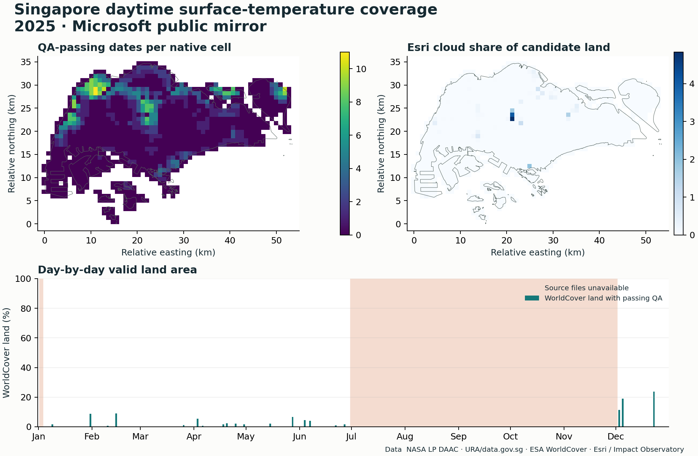

# Tree cover and daytime land surface temperature in Singapore

How does daytime satellite land surface temperature vary with the share of land classified as trees? Does the observed relationship differ with the share classified as built area? This project investigates the question for Singapore using 2025 satellite measurements. The current milestone is a geospatial data feasibility study.

## What the data support

- **Terra MODIS annual route.** None of the observed land meets the prespecified temporal rules. Even if every missing source date passes QA at every cell, at most **7.70%** of the WorldCover land meets all temporal rules. The annual threshold is 80%.
- **2025 land cover.** The Esri map classifies **99.979%** of non-water pixels in the study boundary. The official legend and the original GeoTIFF identify 535,005 pixels as rangeland and 1,478 as cloud.
- **Landsat candidate dates.** Seven dates pass Tier 1 per-scene screening and cover **62.96% to 86.00%** of land individually. Their spatial union is sensitive near the original annual coverage threshold.



[Feasibility results and limitations](docs/FEASIBILITY.md) · [Study protocol](docs/PROTOCOL.md) · [Source attribution and licences](docs/DATA_SOURCES.md)

## Reproduce

The pipeline was run on Linux x86-64 with Python 3.10.12. Run the following from the repository root in an environment that can reach the publishers' public HTTPS data endpoints.

```bash
python3 -m venv .venv
mkdir -p .scratch/tmp .scratch/cache/matplotlib
export TMPDIR="$PWD/.scratch/tmp"
export MPLCONFIGDIR="$PWD/.scratch/cache/matplotlib"
export OPENBLAS_NUM_THREADS=1 OMP_NUM_THREADS=1 GDAL_NUM_THREADS=1
.venv/bin/python -m pip install -r requirements-lock.txt
.venv/bin/python -m pip check
PYTHONPATH=scripts .venv/bin/python -B -m unittest discover -s tests -v
.venv/bin/python -B scripts/fetch_inputs.py spatial
.venv/bin/python -B scripts/fetch_inputs.py modis
.venv/bin/python -B scripts/audit_coverage.py --output .scratch/reproduced-modis
.venv/bin/python -B scripts/screen_landsat.py --output .scratch/reproduced-landsat
```

To use the MODIS files from the original snapshot, replace the MODIS fetch command with the following two copies. The dated inventory in the archived results records the exact source granules used.

```bash
cp data/snapshot/modis_public_daily.npz data/raw/
cp results/modis_public_mirror/source_inventory.csv data/raw/modis_public_daily_inventory.csv
```

The scope, quality criteria and rules for missing dates are documented in the protocol. `coverage.json`, the per-cell table and the daily and monthly tables provide the audit trail. Landsat has a separate 44-scene screening table. The [optional Earth Engine export](docs/MODIS_EXPORT.md) describes an independent input check.

## Contributions

The applicant selected the project, chose the MODIS feasibility check, and provided the documented history of the earlier data work. Codex assisted with source checks, program implementation and execution, figures, and project documentation. The temperature results reflect satellite overpasses and clear-sky conditions. The scientific interpretation is limited to the observed land surface and the scope supported by the data.
