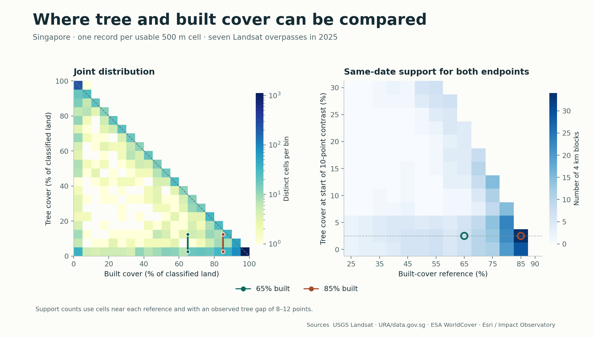
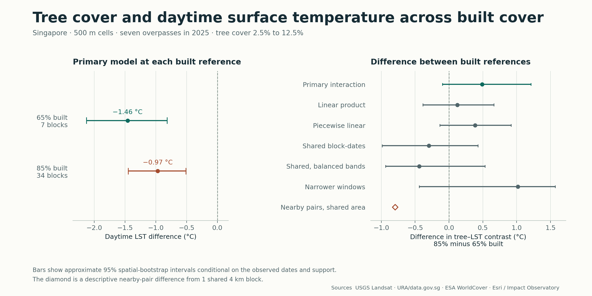

# Does the tree cover association vary with built cover?

On seven clear-sky Landsat overpasses in Singapore in 2025, cells with 12.5% tree cover had lower fitted daytime land surface temperatures (LST) than cells with 2.5% tree cover at both built-cover references. The pooled estimate was 1.46 °C lower at 65% built and 0.97 °C lower at 85% built. The difference between those contrasts was **+0.49 °C** with an approximate 95% interval of **−0.09 to +1.21 °C**. The point estimate reversed sign when both bands were drawn from the same block-dates. The size and direction of the difference remain uncertain.

## Where the data support a comparison

Each point of the study grid is a 500 m cell. The left panel counts each usable cell once. The right panel counts 4 km blocks with two cells observed on the same date, near the two tree-share endpoints in the indicated built band and eight to twelve tree percentage points apart. For example, for tree cover from 10% to 20%, there were zero qualifying blocks at the 25% and 50% built references and 11 at 75%. [Candidate support counts](../results/built_cover_moderation/design/band_support.csv)

The comparison from 2.5% to 12.5% tree cover at 65% and 85% built cover maximized the number of shared spatial blocks across the candidate grid. Selection used cover shares, locations and already accepted cell-date IDs before fitting Stage 2 temperatures. The earlier island-wide model was available when designing this follow-up. The main windows allow up to five tree percentage points around each endpoint and require a built share within less than ten points of its reference. [Protocol](BUILT_COVER_PROTOCOL.md) · [Frozen design record](../results/built_cover_moderation/design/design_record.json) · [Geographic support map](../results/built_cover_moderation/design/geographic_support.png)

| Built reference | Distinct cells near low / high tree endpoints | Distinct cells within tighter endpoint windows | Blocks with both endpoints | Block-dates with both endpoints | Cells in pooled model |
| --- | ---: | ---: | ---: | ---: | ---: |
| 65% | 61 / 19 | 26 / 8 | 7 | 40 | 35 |
| 85% | 218 / 102 | 71 / 43 | 34 | 210 | 249 |

The tighter endpoint windows in the table use 2.5 tree points and five built points around each nominal endpoint. Both built bands had supported endpoints on the same date in **6 shared blocks** across **36 block-dates**. Their intersection spanned all seven overpasses but left only 70 distinct cells and 404 cell-dates. Requiring the Stage 1 nearby-pair rules reduced shared support to **one block over six dates**. [Shared-support audit](../results/built_cover_moderation/design/shared_support.csv) · [Sample comparison](../results/built_cover_moderation/analysis/sample_comparison.csv)

## Model and estimated contrasts

The pooled model uses 1,641 cell-dates from 284 cells. A cell-date enters the fit when its built band and block-date support both tree endpoints. The model adjusts for land share and uses a separate intercept for each date and 4 km block combination. It includes tree and built shares, separate quadratic terms and a tree-by-built product. Each overpass has equal total weight. For each reference, the contrast is the fitted LST at 12.5% tree cover minus the fitted LST at 2.5% tree cover, with built cover and land share held fixed. Subtracting the 65% contrast from the 85% contrast gives the difference between associations. [Analysis code](../scripts/analyze_built_cover.py)

| Fixed tree contrast, 2.5% to 12.5% | Estimated LST difference | Approximate 95% spatial-bootstrap interval |
| --- | ---: | ---: |
| At 65% built cover | −1.46 °C | −2.13 to −0.82 °C |
| At 85% built cover | −0.97 °C | −1.45 to −0.51 °C |
| 85% minus 65% | **+0.49 °C** | **−0.09 to +1.21 °C** |

The interval for the difference uses the two estimates from the same bootstrap draw. Each draw resamples whole blocks, retaining their records across overpasses and recalculating date weights. Of 1,999 attempted draws, 1,745 supplied both bands on every date and a full-rank fit. The intervals are conditional on the seven overpasses and the supported draws. Seven blocks inform the lower built reference, which limits spatial replication even though the pooled fit has 35 blocks. [Machine-readable estimates](../results/built_cover_moderation/analysis/estimates.json) · [Spatial resampling](https://doi.org/10.1214/009053606000000551) · [Few-cluster inference](https://escholarship.org/uc/item/1jq5d0pq)

## Nonlinearity and sensitivity

On identical rows, the additive quadratic model assigns a common contrast of −1.07 °C at both references. Adding the interaction changed the within-sample RMSE from 1.635 °C to 1.631 °C. The linear-product model estimated a +0.13 °C difference. Allowing slope changes at 7.5% tree cover and 75% built cover, with the resulting basis terms interacted, gave +0.39 °C. Both alternatives had intervals spanning zero. [Interaction specification and support](https://doi.org/10.1017/pan.2018.46)

| Sensitivity check | 85% minus 65% built | Approximate 95% interval |
| --- | ---: | ---: |
| Linear product | +0.13 °C | −0.39 to +0.66 °C |
| Piecewise linear interaction | +0.39 °C | −0.13 to +0.92 °C |
| Same block-dates in both bands | −0.30 °C | −0.99 to +0.43 °C |
| Same block-dates, separate band intercepts and equal date-band weights | −0.44 °C | −0.94 to +0.53 °C |
| Narrower endpoint and built windows | +1.02 °C | −0.44 to +1.57 °C |
| 8 km nested resampling | +0.49 °C | −0.13 to +1.24 °C |
| Cloud distance ≥0.5 km and ST_QA ≤4 K | +0.59 °C | −0.10 to +1.14 °C |

For the *narrower windows* fit, support uses 2.5 tree points and less than 7.5 built points around the references. Only one block supports both bands under this rule, and 440 of 999 bootstrap draws were retained for the pooled estimate. The 4 K screen retained 377 of 999 draws. Joint date coverage fell to zero with the same cloud-distance rule and a 2 K cutoff.

Changing the block origin or size, the water mask, and the weighting gave point estimates from +0.21 to +1.04 °C. All corresponding intervals spanned zero. Starting the ten-point comparison at 0% instead of 2.5% gave +0.14 °C. Omitting one date at a time gave +0.42 to +0.55 °C with all seven intervals spanning zero. Omitting one block at a time gave +0.36 to +0.65 °C in point estimates. [All specifications and draw counts](../results/built_cover_moderation/analysis/robustness.csv) · [Leave one date out](../results/built_cover_moderation/analysis/leave_one_date_out.csv) · [Leave one block out](../results/built_cover_moderation/analysis/leave_one_block_out.csv)

With the Stage 1 balance rules, the two cells in a pair were at most 2 km apart, had built shares within five points and land shares within ten points. The observed LST difference was scaled by the pair's eight- to twelve-point tree gap to express it per ten points. Across the dates available in both bands, 17 pairs near 65% built averaged −0.70 °C and 109 near 85% built averaged −1.12 °C with equal weight per date. In the one jointly supported block, 6 and 12 pairs across six dates averaged −0.37 °C and −1.16 °C respectively. The latter higher-minus-lower difference of −0.79 °C describes that block and has one unit of spatial replication. [Pair-level contrasts](../results/built_cover_moderation/analysis/paired_temperatures.csv)

The pooled regressions compare within local areas but draw the two built references largely from different sets of areas. Restricting both references to the same areas changes the sample and reverses the point difference. That sensitivity matters more for interpreting the sign than the small change in fit from adding an interaction. These estimates describe observed surfaces around 11:16 a.m. Singapore time on the seven selected clear-sky dates. At fixed built share, higher tree share also means lower shares of other land-cover classes. [Stage 1 local comparison](LOCAL_COMPARISON_RESULTS.md) · [Reproduction commands](REPRODUCE.md#stage-2-variation-with-built-cover)
