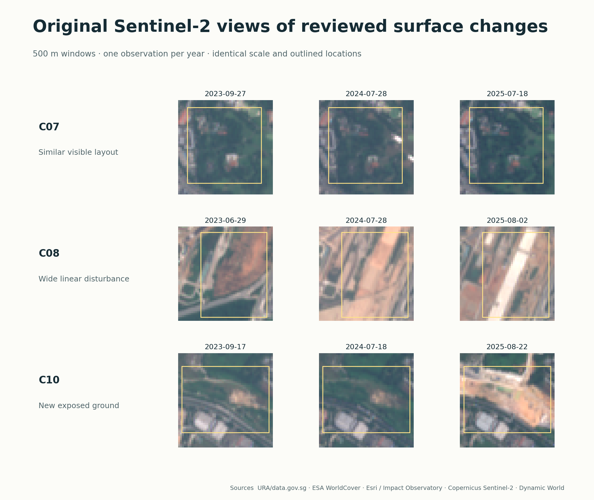
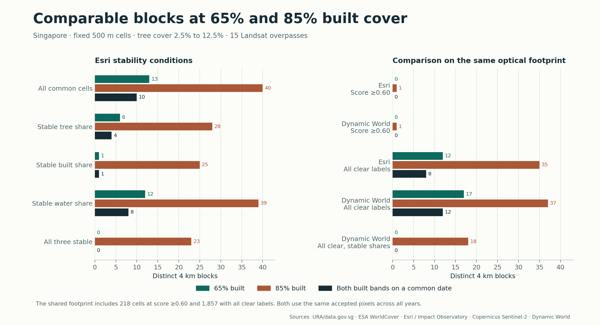

# Land-cover audit of the 65% and 85% built comparisons

The built-share stability rule accounts for most of the loss at the 65% reference. The original imagery also shows physical changes in several of the affected cells. A second classification provides additional comparisons in an exploratory, low-confidence-inclusive analysis. At both sources' original five-point stability limit, the 65% comparison again has zero eligible blocks.

## What removes the low-built reference

The 65% built reference lost almost all local comparisons under the Esri built-share stability condition. Across the 15 Landsat dates, the unrestricted common geography supplied **13** distinct blocks with the 65% endpoint contrast and **40** with the 85% contrast. Ten blocks supplied both bands in the same block and overpass. The built-share range limit alone reduced these totals to **1**, **25**, and **1**. The tree and built limits together left zero blocks supporting the 65% contrast. The water limit alone retained 12 of the 13 lower-band blocks. These counts use the original local pairing rules and distinguish blocks from their repeated use on different dates. [All eight Esri filter combinations](../results/cover_support_audit/design/esri_filter_counts.csv) · [Block-date support](../results/cover_support_audit/design/esri_filter_block_dates.csv)

| Cross-year share limits in Esri | 65% built blocks | 85% built blocks | Blocks with both bands on one date |
| --- | ---: | ---: | ---: |
| All 2,442 common cells | 13 | 40 | 10 |
| Tree share range ≤5 points | 6 | 28 | 4 |
| Built share range ≤5 points | 1 | 25 | 1 |
| Water share range ≤5 points | 12 | 39 | 8 |
| All three share ranges ≤5 points | 0 | 23 | 0 |

There were **19 distinct cells** close to 65% built and 12.5% tree cover in at least one Esri year. Built share spanned more than five percentage points in 17 of the 19, tree share did so in 13, and water share did so in zero. These are overlapping classifications of the same review cells. The 5, 10 and 7 nominal endpoint counts from 2023, 2024 and 2025 include repeat observations of several cells. [Critical-cell registry](../results/cover_support_audit/design/critical_cells.csv) · [Location map](../results/cover_support_audit/figures/audit_cells.png)

## Optical review

The optical review uses 15 June–September acquisitions across 2023–2025. Original Level-1C top-of-atmosphere reflectance supplies the RGB and near-infrared evidence. A cloud mask from matched Level-2A products screens each acquisition. Dynamic World was reconstructed from the authors' published weights on these scenes with the local mask and seasonal probability averaging. The two land-cover classifications share Sentinel-2 imagery as a source, and the reflectance gives a way to inspect physical changes directly. [Protocol](COVER_SUPPORT_AUDIT_PROTOCOL.md) · [Unsigned scene and band manifest](../results/cover_support_audit/imagery/sentinel_manifest.json) · [Released model runner](https://github.com/google/dynamicworld/tree/0dd288fae5fb5291d988e5ea3c12eb91df481ec5)

Visual review found **seven clear, coherent surface changes** in C03, C04, C08, C09, C10, C12 and C13. **Seven** more cells had localized disturbance or vegetation-signal changes. In **five** cells the change remained unresolved. These classifications describe 19 targeted cells and the visible surfaces over the selected seasons. [Case-by-case evidence](../results/cover_support_audit/analysis/case_review.csv) · [NDVI and classification diagnostics](../results/cover_support_audit/analysis/image_diagnostics.csv)

In C08 a wide diagonal corridor contains exposed ground in 2024 and a bright continuous strip in 2025. In C10 a broad pale clearing appears in 2025 where a darker surface was visible the prior year. The largest connected patches with a repeated decline in NDVI were 11.47 ha in C08 from 2023 to 2025 and 10.83 ha in C10 from 2024 to 2025. These areas quantify changes in vegetation signal. The images show surface disturbance at each site. C07 shows a broadly similar arrangement of roofs, paths and green patches despite Esri ranges of 11.9 points in built share and 13.7 in tree share. C17 had only about 68% repeat-clear land in comparisons involving 2024. [NDVI and classification diagnostics](../results/cover_support_audit/analysis/image_diagnostics.csv)

[C01–C04](../results/cover_support_audit/figures/chips/C01-C04.png) · [C05–C08](../results/cover_support_audit/figures/chips/C05-C08.png) · [C09–C12](../results/cover_support_audit/figures/chips/C09-C12.png) · [C13–C16](../results/cover_support_audit/figures/chips/C13-C16.png) · [C17–C19](../results/cover_support_audit/figures/chips/C17-C19.png)

## Recount on the same pixels

Repeated clear optical observations alone retained 1,910 common cells and 11 of the original 13 blocks with a 65% built comparison. After requiring recognized nonwater labels from both sources on 80% of the same land centers across all years, 1,857 cells and the same 11 original blocks remained. The 0.50, 0.60 and 0.70 probability cutoffs retained 480, 218 and 11 cells, respectively. Each cutoff left zero blocks with a 65% contrast, even under the original Esri fractions on those retained cell IDs. This locates the additional loss in the probability screen for this optical dataset. [Optical filter counts](../results/cover_support_audit/analysis/optical_filter_counts.csv)

Across the 19 targeted cells, requiring a 0.60 score in both 2023 and 2025 left between 0.3% and 23.7% of fixed land with matched nonwater labels. With all clear labels, 17 of the 19 retained at least 80% for that year-pair. [Per-case coverage](../results/cover_support_audit/analysis/image_diagnostics.csv)

| Source and rule on identical pixels across years | Cells | 65% blocks | 85% blocks | Blocks with both on one date | Blocks with both under nearby-pair rules |
| --- | ---: | ---: | ---: | ---: | ---: |
| Esri, Dynamic World score ≥0.60 | 218 | 0 | 1 | 0 | 0 |
| Dynamic World, score ≥0.60 | 218 | 0 | 1 | 0 | 0 |
| Esri, all clear labels | 1,857 | 12 | 35 | 8 | 1 |
| Dynamic World, all clear labels | 1,857 | 17 | 37 | 12 | 2 |
| Esri, all clear labels and stable shares | 1,249 | 0 | 18 | 0 | 0 |
| Dynamic World, all clear labels and stable shares | 1,083 | 0 | 18 | 0 | 0 |

“All clear labels” includes pixels with at least two accepted optical observations in each year and uses the most probable class regardless of the score. This exploratory diagnostic showed only **two** blocks and ten block-dates where the same two-band comparison was supported by **both** classified products. The original stricter nearby-pair rules reduced that cross-product agreement to zero blocks. The annual-footprint sensitivity at 0.60 used 277 common cells and still had zero 65% contrasts. [All support counts](../results/cover_support_audit/analysis/matched_support_counts.csv) · [Identical block-date support across products](../results/cover_support_audit/analysis/support_agreement.csv)

The two sources can agree on change direction while assigning different amounts of built area. In C08, with all clear labels on the same observed pixels, the Esri and Dynamic World built shares increased by 29.3 and 19.4 percentage points respectively from 2023 to 2025. Both identify sparse vegetation along the disturbed corridor, while the mapped boundary between bare and built surfaces differs. In C07, over the same years, the Esri built share rose 11.9 points and the Dynamic World built share fell 11.8 points despite similar visible geometry. In C13 a real change is visible in the surfaces and routes, but the two products give built-share differences of +24.9 and −3.8 points. These cases explain why visible change and movement into a numerical built band require separate evidence. [Per-case paired pixel estimates](../results/cover_support_audit/analysis/image_diagnostics.csv) · [Esri class transitions](../results/cover_support_audit/analysis/esri_label_transitions.csv)

The audit supports two conclusions about the earlier comparison. Several critical locations visibly changed, so a cross-year stability requirement removes some places with real disturbance. Other losses depend on how mixed land cover is classified and on which pixels retain sufficient confidence. The fixed 65% contrast remains unsupported under the cross-year stability requirement in both classifications. [Stage 2 report](BUILT_COVER_RESULTS.md) · [Stage 3 validation](OVERPASS_VALIDATION_RESULTS.md)
