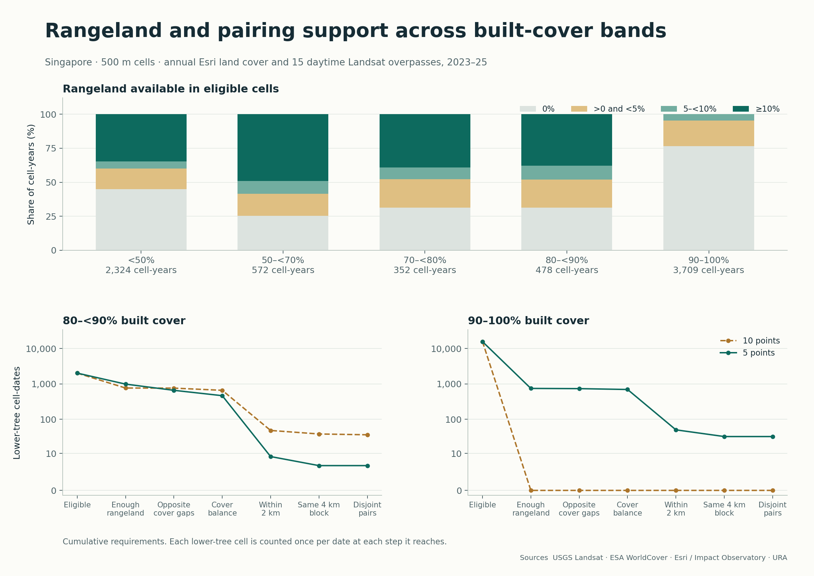
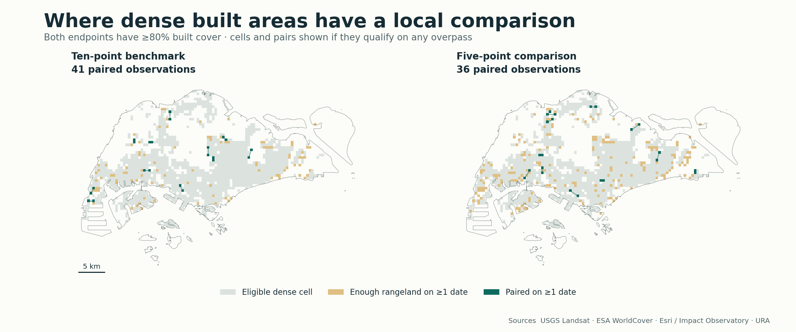
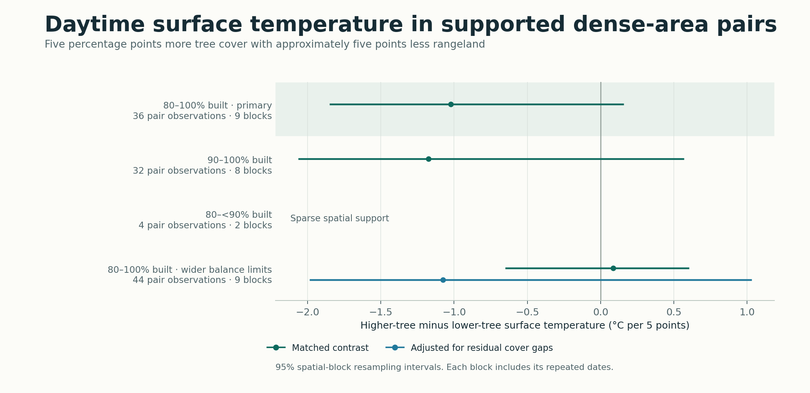

# Stage 6 tree cover replacing rangeland in dense built areas

In cells with at least 90% built cover, no eligible observation had ten percentage points of mapped grass and shrub cover available for exchange. A five-point exchange had local support, with 32 same-date pair observations in eight 4 km blocks. Pooling cells with at least 80% built cover gave 36 pair observations in nine blocks. Their matched daytime land surface temperature contrast was **−1.02 °C per five points** [−1.85, +0.16]. The estimate varied with the matching limits. [Support by band](../results/dense_tree_swap/design/support_by_band.csv) · [Temperature estimates](../results/dense_tree_swap/analysis/estimates.csv)

## How comparable cells are lost

Use the existing 500 m grid and 15 Landsat overpasses from 2023–25. Built share measures the fraction of recognized non-water study-land pixels classified as built area. Rangeland is the Esri class that includes grass and some shrub or scrub cover. The annual land-cover counts and observation-quality rules come from Stages 3 and 5. [Frozen protocol](DENSE_TREE_SWAP_PROTOCOL.md) · [Esri product legend](https://ic.imagery1.arcgis.com/arcgis/rest/services/Sentinel2_10m_LandCover/ImageServer/rasterFunctionInfos)

The table counts eligible lower-tree donors and disjoint same-date pairs after applying the corresponding rules. A possible donor contains at least the target amount of rangeland. The pooled band permits pairs across the 90% boundary. The other rows require both endpoints to be in the same band.

| Built cover | Eligible cell-dates | Ten-point donors | Ten-point pairs | Five-point donors | Five-point pairs |
| --- | ---: | ---: | ---: | ---: | ---: |
| Below 50% | 9,508 | 3,235 | 127 | 3,785 | 70 |
| 50–<70% | 2,367 | 1,145 | 26 | 1,383 | 12 |
| 70–<80% | 1,476 | 597 | 10 | 714 | 0 |
| 80–<90% | 2,031 | 770 | 36 | 993 | 4 |
| 90–100% | 15,675 | 0 | 0 | 750 | 32 |
| 80–100% pooled | 17,706 | 770 | 41 | 1,743 | 36 |

In the 90–100% band, 2,836 of 3,709 eligible cell-years had zero mapped rangeland. Only 172 cell-years, or 4.6%, had at least 5%. Across available dates, 750 of 15,675 cell-dates reached the five-point donor threshold. Of those, **740** had a same-date partner with opposite tree and rangeland changes of four to six points. **700** still had a partner after applying the cover-balance limits. **50** had one within 2 km, and **32** met the additional same-block requirement. All 32 supplied disjoint pairs. Thus rangeland scarcity limits the starting pool, and the local geography removes most of the remaining balanced comparisons. [Rangeland distribution](../results/dense_tree_swap/design/composition_by_band.csv) · [Cumulative counts](../results/dense_tree_swap/design/support_by_band.csv)

The 80–<90% band had 468 five-point donors with a compositionally balanced partner anywhere in the band on the same date. Eight retained a partner within 2 km, and four in the same block. Relaxing the composition balance limits left four pairs. In the 90–100% band, the relaxed limits increased the count from 32 to 40. In the pooled ≥80% band they increased the count from 36 to 44 while the number of represented blocks was nine in both designs. The five-point rule opens a comparison above 90% built cover. Its narrower gap tolerances and different observed cover combinations also account for the differences between the five- and ten-point pair counts. [Counts by overpass](../results/dense_tree_swap/design/support_by_date.csv) · [Individual pairs](../results/dense_tree_swap/design/pairs.csv)

## Temperature among the supported pairs

The primary 36 pair observations comprise **12 distinct spatial pairs**, in **nine blocks** on **14 overpasses**. Actual built shares at their endpoints range from **87.88% to 94.64%**. With equal weight by date, the mean tree and rangeland gaps are +5.00 and −5.19 percentage points. The mean absolute built-cover gap is 0.37 point and the average separation is 1.28 km. The protocol and these pair IDs were frozen in commit `58c471a` before the analysis opened the temperature columns. [Design record](../results/dense_tree_swap/design/design_record.json) · [Pair balance](../results/dense_tree_swap/analysis/pair_balance.csv)

| Sample and estimate | Pair observations | Blocks | Contrast (°C) | 95% spatial interval (°C) |
| --- | ---: | ---: | ---: | ---: |
| 80–100% built, primary matched | 36 | 9 | −1.02 | [−1.85, +0.16] |
| 90–100% built, matched | 32 | 8 | −1.17 | [−2.06, +0.57] |
| 80–<90% built | 4 | 2 | Sparse support | |
| 80–100% built, wider limits, matched | 44 | 9 | +0.09 | [−0.65, +0.60] |
| 80–100% built, wider limits, adjusted | 44 | 9 | −1.08 | [−1.99, +1.03] |

The matched estimate scales each observed temperature difference to a five-point tree gap. The adjusted model estimates the exchange at fixed built, other and study-land shares. The primary sample retained full adjustment rank in 1,793 of 1,999 spatial draws, below the frozen 95% threshold. The ≥90% sample lost adjustment rank when one block was omitted. The wider set met the adjustment checks with 1,953 draws. Both estimates on that set used the same draws. [Analysis protocol](DENSE_TREE_SWAP_PROTOCOL.md#five-point-temperature-contrast) · [Temperatures in the fitted pairs](../results/dense_tree_swap/analysis/paired_temperatures.csv)

The primary and wider designs share 35 exact pair-date records. Nine records unique to the wider design, in two blocks, account for 24.4% of its total weight. Their mean normalized LST difference is **+2.87 °C**. The shared records also receive different weights because the estimate gives every included date equal total weight. The observed matching sensitivity therefore reflects both which pairs enter and how they are weighted. [Pair overlap and decomposition](../results/dense_tree_swap/analysis/pair_overlap.csv)

In the primary sample, the largest block contributes 32.1% of the weight, with about five effective equally weighted blocks. Omitting individual blocks gives point estimates from −1.22 to −0.34 °C. Across the plausible comparisons, the spatial intervals allow both lower and higher temperatures. The study describes measured daytime surface temperatures for the land-cover configurations with local support. Satellite cover classification, geographic concentration, and within-block differences in shade, materials, and airflow limit the interpretation. [Block influence](../results/dense_tree_swap/analysis/leave_one_block_out.csv)

## Reproduction

Regenerate the design from the committed land-cover counts and observation registry, then run the temperature fit and rebuild all three figures. The server rerun regenerated the design, result tables, and figures byte for byte. [Commands and file inventory](REPRODUCE.md#stage-6-tree-for-rangeland-comparison-in-dense-built-areas)
