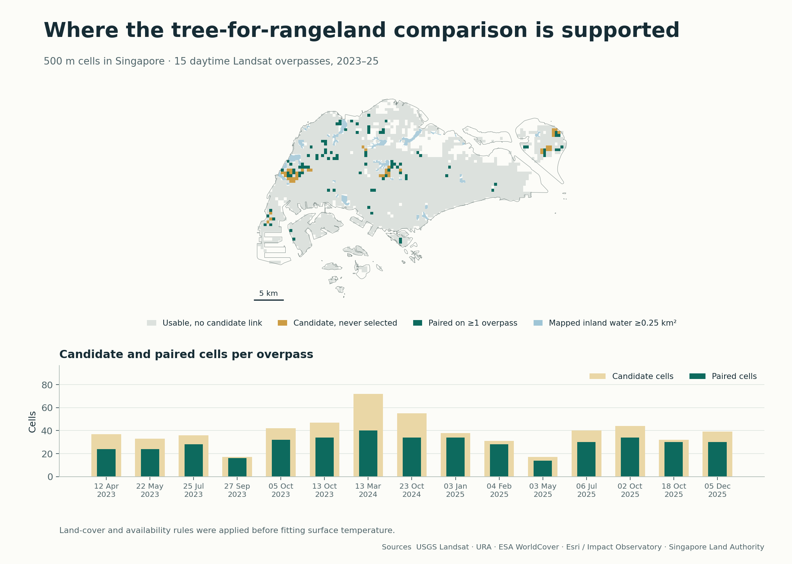
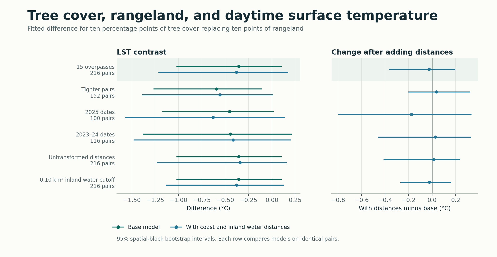

# Stage 5 tree cover replacing grass and shrub cover

Across 216 same-date pairs, ten percentage points more tree cover and ten points less mapped grass and shrub cover corresponded to **0.355 °C lower daytime land surface temperature** at fixed built, other, and study-land shares. Adding coast and large inland water distances to the same pairs gave **0.379 °C lower**. The change in the estimate was **−0.024 °C**, with a 95% spatial-bootstrap interval of **−0.37 to +0.20 °C**. The intervals for both models also span zero. [Full estimate table](../results/grass_tree_substitution/analysis/estimates.csv)

## Where the comparison has support

Of 2,500 distinct 500 m cells eligible on at least one of the 15 overpasses, 135 had a candidate link. The disjoint matching retained **94 cells in 24 spatial blocks**, or 3.8% of the eligible geography by cell count. It used 432 of the 31,057 eligible cell-dates. The 216 paired observations comprise 54 distinct ordered cell pairs observed across one or more dates. Each overpass contributed 7–20 pairs drawn from 4–16 blocks. The support and geometry were frozen at commit `b395296` before extracting temperatures for these pairs. [Frozen design](../results/grass_tree_substitution/design/design_record.json) · [Grid IDs and support by date](../results/grass_tree_substitution/design/cell_date_support.csv)

The paired cells are concentrated in the west, northwest and central parts of the main island, with some on Pulau Tekong and elsewhere. Counting each cell once per year, the median built share was **4.0% among paired cells** and **89.8% among all eligible cells**. The middle half of paired cells spanned **0–78.4% built cover** and **10.2–86.8% tree cover**. The combination of two nearby cells with similar built shares and opposing tree and rangeland gaps is uncommon in the more built-up part of the eligible sample. [Cell-year class counts and covariates](../results/grass_tree_substitution/design/cell_covariates.csv)

The equal-date mean gaps were **+10.04 points of trees** and **−10.29 points of rangeland**. Mean absolute differences were **0.64 points of built cover**, **0.25 points of other cover**, and **1.77 points of study-land share**. The mean pair separation was 1.06 km. The lower-tree endpoint had at least ten points of rangeland by design. [Pair balance](../results/grass_tree_substitution/analysis/pair_balance_by_date.csv)

## Same-pair estimates

Both endpoints were observed in the same overpass and 4 km block. The base model compares their LST after accounting for residual gaps in built cover, its squared term, other cover and study-land share. The coefficient describes the exchange between trees and rangeland when those shares are fixed. The water model adds distance from cell centers to the SLA coastline and to one of 21 mapped inland water components of at least 0.25 km². Both distances enter as `log(1 + km)`. For all comparisons below the weights, 216 paired observations, and retained bootstrap draws are identical. [Protocol](GRASS_TREE_SUBSTITUTION_PROTOCOL.md) · [Water components](../results/grass_tree_substitution/design/water_components.csv)

| Adjustments | LST contrast (°C) | 95% interval (°C) | Change from base (°C) | 95% interval for change (°C) |
| --- | ---: | ---: | ---: | ---: |
| Base | −0.355 | [−1.02, +0.10] | | |
| Base + coast | −0.348 | [−1.09, +0.11] | +0.007 | [−0.19, +0.12] |
| Base + inland water | −0.378 | [−1.20, +0.16] | −0.023 | [−0.34, +0.16] |
| Base + both | −0.379 | [−1.22, +0.18] | −0.024 | [−0.37, +0.20] |

The observed pair temperature difference standardized to a ten-point tree gap averaged **−0.436 °C** [−0.97, +0.07]. The intervals use 1,975 of 1,999 common draws, resampling 4 km blocks with their full date histories and giving each overpass equal total weight. Each change interval comes from the differences between the coefficients in the same resampling iterations. [Paired LSTs](../results/grass_tree_substitution/analysis/paired_temperatures.csv) · [Analysis record](../results/grass_tree_substitution/analysis/analysis_record.json)

## Sensitivity and interpretation

The tighter matching retained 152 pairs in 18 blocks. The jointly adjusted estimate was **−0.56 °C** [−1.39, +0.01]. On the seven 2025 overpasses it was **−0.63 °C** [−1.57, +0.14], and on the eight additional 2023–24 overpasses it was **−0.42 °C** [−1.48, +0.21]. Using distances in kilometers directly gave −0.34 °C. Lowering the water-area cutoff to 0.10 km² gave −0.38 °C. Omitting one date at a time gave jointly adjusted point estimates from −0.44 to −0.28 °C. [Sensitivity estimates](../results/grass_tree_substitution/analysis/estimates.csv) · [Omit-one-date results](../results/grass_tree_substitution/analysis/leave_one_overpass_out.csv)

The adjusted point estimates describe cooler surfaces on this comparison sample, and their intervals allow small positive differences. The coast and inland water terms control for mapped proximity. Their inclusion leaves uncertainty about the size of the change. One map edition supplies the distances in every year, which treats shoreline and water outlines as fixed for this analysis. The observed cover is a satellite classification. The exchange is an observational daytime LST contrast for the supported cells and overpasses, with possible remaining differences in building form, shade, vegetation and wind.

## Reproduction

The design was regenerated from the original spatial inputs and the archived SLA file. The models and both figures were then reproduced in a separate scratch directory within the research project. The workflow uses the locked Stage 3 temperature inputs and the repository's Python environment. [Commands and output inventory](REPRODUCE.md#stage-5-tree-for-rangeland-substitution) · [Source definitions](DATA_SOURCES.md)
