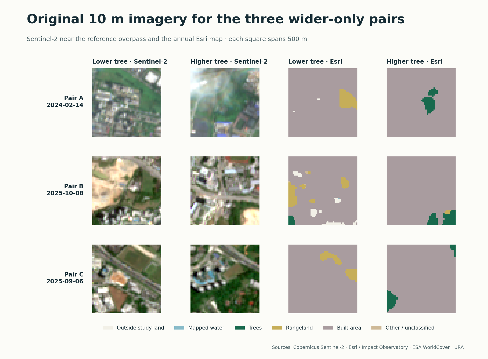
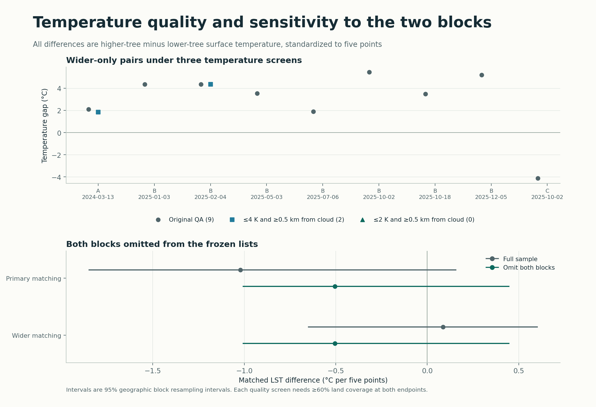

# Stage 7 image and temperature audit of the wider-only pairs

The nine extra Stage 6 pair observations came from three distinct spatial pairs. One Bukit Merah pair appeared on seven overpasses and accounted for **20.0%** of the wider fit's original date weight. When both contributing blocks were omitted from the frozen pair lists, the primary and wider comparisons retained identical records. Their common matched estimate was **−0.50 °C per five points** with a 95% spatial interval of **−1.01 to +0.45 °C**. [Frozen pair list](../results/influential_pair_audit/design/pair_registry.csv) · [Block omission results](../results/influential_pair_audit/analysis/block_omission.csv)

## Cover and optical evidence

The nine pair observations met the primary limits for built share, other cover, separation, and the individual tree and rangeland changes. Each exceeded the primary one-point limit on the combined tree-plus-rangeland gap. Tree cover rose by **4.04–4.56 percentage points**, rangeland fell by **5.40–5.90 points**, and built share rose by **1.05–2.00 points**. These values use the annual Esri classes on the fixed classified non-water domain. The combined-cover rule was applied before fitting temperatures. [Pair-level limits and QA](../results/influential_pair_audit/analysis/pair_quality.csv) · [Original screening rules](DENSE_TREE_SWAP_PROTOCOL.md#which-requirement-removes-support)

| Pair and planning area | Block | Visits | Tree gap (points) | Rangeland gap (points) | Built gap (points) | Observed higher-minus-lower LST (°C) |
| --- | --- | ---: | ---: | ---: | ---: | ---: |
| A · Jurong East | (89, 36) | 1 | +4.56 | −5.61 | +1.05 | +1.92 |
| B · Bukit Merah | (91, 35) | 7 | +4.19 | −5.90 | +2.00 | +1.59 to +4.56 |
| C · Queenstown | (91, 35) | 1 | +4.04 | −5.40 | +1.36 | −3.32 |

The same-overpass Landsat windows show consistent spatial differences within pair B. The lower-tree square contains a large light-toned open surface and a darker vegetation strip alongside built areas. The higher-tree square has a different layout of roads, roofs and vegetation. Their center distances to the mapped coast are **0.24 and 0.64 km**, respectively. The higher-tree endpoint was warmer on all seven overpasses, with gaps of **+1.89 to +5.45 °C** when scaled to a five-point tree gap. The other pair in block (91, 35), in Queenstown, shows the opposite temperature direction on 2 October and a visibly greener higher-tree square. [Original same-day Landsat images](../results/influential_pair_audit/figures/landsat_original_pairs.png) · [Site inspection notes](../results/influential_pair_audit/image_review/site_notes.csv)

Sentinel-2 supplies 10 m optical context on 14 February 2024, 8 October 2025 and 6 September 2025, respectively 28 days before, six days after, and 26 days before the relevant Landsat reference overpasses. The Jurong East context image shows some visible haze or thin cloud. The qualitatively different surface mixes and date offsets limit assignment of individual Esri labels from these images. [Source selections and clear fractions](../data/snapshot/influential_pair_audit/sentinel_sources.csv) · [USGS Landsat product guide](https://www.usgs.gov/media/files/landsat-8-9-collection-2-level-2-science-product-guide)

## Landsat temperature quality

Re-aggregating the native thermal windows reproduced the saved Stage 3 temperatures and passing areas for all 18 endpoints. Use the earlier temperature screens to assess whether the signs persist in higher-quality parts of the cells. The 4 K screen requires reported uncertainty of at most 4 K and distance to a mapped cloud of at least 0.50 km. The pair is eligible only when the qualifying pixels cover at least 60% of the study land at both endpoints. **Two of nine** observations remained eligible.

| Retained pair and date | Minimum endpoint coverage | Original (°C per five points) | 4 K screen (°C per five points) |
| --- | ---: | ---: | ---: |
| A · 13 March 2024 | 93.8% | +2.10 | +1.85 |
| B · 4 February 2025 | 100.0% | +4.37 | +4.37 |

The 2 K screen provided zero passing study-land area at the 18 endpoints. No wider-only pair supplies that check. Six of the seven Bukit Merah observations lack common coverage under the 4 K screen. For example, on 3 May the original thermal coverage at the lower-tree endpoint was 65.9%, and the built gap among classified pixels contributing to both endpoint estimates was +3.65 points against +2.00 points on the full cells. At Queenstown, the higher-tree endpoint retained only 1.0% coverage under the 4 K screen. The quality record supports the warmer direction for the two retained pairs. The remaining seven retain only the original temperature comparison. [Endpoint quality and spectral summaries](../results/influential_pair_audit/analysis/endpoint_quality.csv) · [USGS quality bands](https://www.usgs.gov/landsat-missions/landsat-collection-2-quality-assessment-bands)

## Simultaneous omission of both blocks

Omit blocks (89, 36) and (91, 35) simultaneously from both original match lists. The primary comparison loses eight observations. The wider comparison loses 16, including the nine audited observations. Both retain the **same 28 pair-date records**, consisting of nine distinct spatial pairs, 11 overpasses, and seven blocks. The reduced samples have the same date weights and therefore the same matched estimate. Each change interval below uses common block multiplicities before and after omission. [Remaining IDs](../results/influential_pair_audit/analysis/omission_retained_pairs.csv) · [Paired changes](../results/influential_pair_audit/analysis/omission_changes.csv)

| Frozen matching rule | Full sample (°C) | Both blocks omitted (°C) | Change (°C) | 95% interval for change (°C) |
| --- | ---: | ---: | ---: | ---: |
| Primary | −1.02 | −0.50 | +0.52 | [−0.35, +1.68] |
| Wider | +0.09 | −0.50 | −0.59 | [−1.18, +0.04] |

With original date weights carried into the retained observations, the two omitted-sample estimates are −0.42 °C and −0.36 °C, respectively. The wider fit supported residual cover adjustment on the full sample. After omission, the shared sample retains adjustment rank in **1,761 of 1,999** draws. Under the Stage 6 threshold of 95%, its result uses the matched comparison. The analysis describes a sensitivity of the observed high-built comparisons to two chosen blocks. The intervals for the remaining contrast and for both changes include zero. [Diagnostics and intervals](../results/influential_pair_audit/analysis/block_omission.csv) · [Stage 7 analysis protocol](INFLUENTIAL_PAIR_AUDIT_PROTOCOL.md)

## Reproduction

The design was fixed at commit `98f62fe`. Original imagery, quality results, and the site review were recorded at `9e73aeb` before the two-block omission run. The checksum inventory preserves the optical and thermal windows and the analysis can start from the Git snapshots. [Replay commands and contents](REPRODUCE.md#stage-7-audit-of-the-wider-only-dense-area-pairs)
