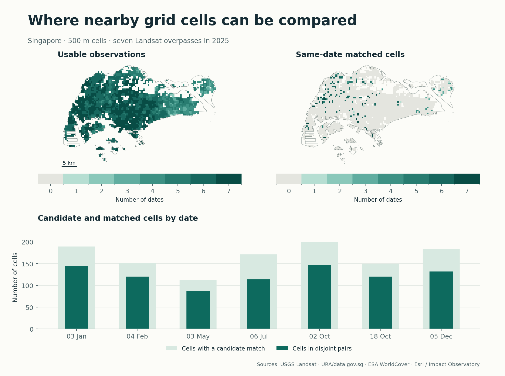
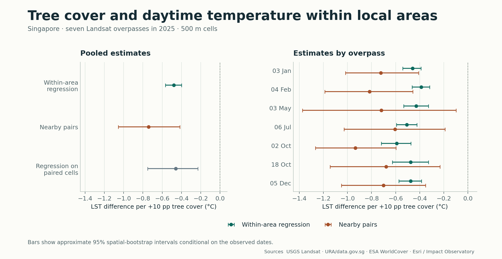
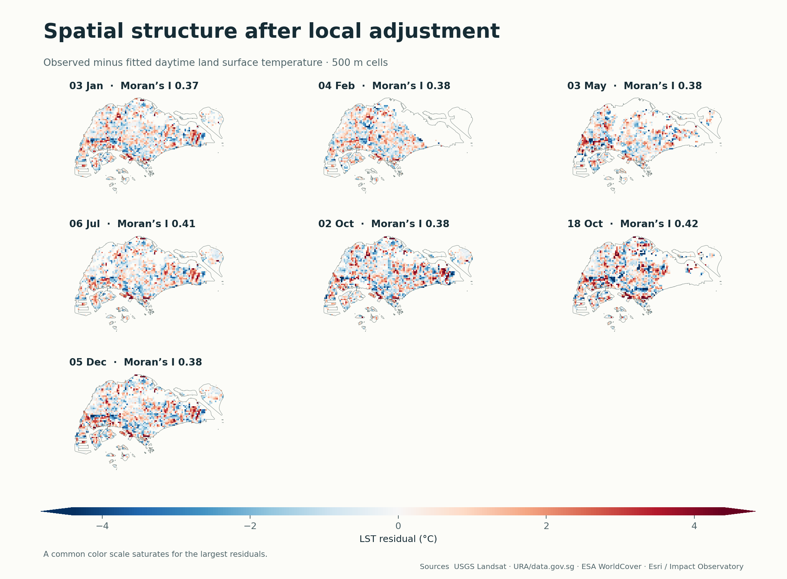

# Stage 1 local comparison of tree cover and daytime surface temperature

Across seven 2025 Landsat overpasses, a 10-percentage-point higher tree share was associated with **0.48 °C lower daytime land surface temperature** in the primary within-area regression. Nearby matched pairs also showed cooler surfaces with higher tree cover. Those pairs were concentrated in a smaller, greener part of the usable sample, and their mean difference was larger. The estimates describe satellite-observed surface temperature around 11:16 a.m. Singapore time on the study dates. [Estimates](../results/local_comparison/analysis/estimates.json)

## Comparison design

Use the baseline 500 m grid, the seven selected overpasses, and the original temperature and classification quality rules. The main regression compares cells within the same 4 km UTM block and date. Every block-date has its own intercept. The regression adjusts for linear and quadratic terms in built cover and for land share, with equal total weight per date. The slope is expressed in degrees Celsius per 10 percentage points of tree cover. Single-cell block-dates contribute no within-area comparison. Omitting them leaves 14,641 cell-dates, 2,486 distinct cells, and 469 block-date groups.

For the pair comparison, both cells must have usable temperatures on the same date and be in the same 4 km block. Their centers are within 2 km, built shares differ by at most 5 percentage points, land shares by at most 10 points, and tree shares by 8–12 points. Matching maximizes the number of disjoint pairs, then minimizes differences in these variables and distance using the documented cost. The pair estimate averages each date's mean change in LST scaled to a ten-point tree-cover difference. The protocol and map were committed before the follow-up temperature estimation. [Protocol](LOCAL_COMPARISON_PROTOCOL.md) · [Frozen design and input hashes](../results/local_comparison/design/design_record.json)

## Geographic and land-cover support

From 2,491 cells with usable data on at least one date, 213 had a candidate match on some date. The disjoint design selected **431 pairs across seven dates**, with 43–73 pairs on an individual date. It involved **160 distinct cells across 34 spatial blocks**. Cells can recur on different dates. The mean distance was 1.04 km, mean tree-cover gap was 10.05 percentage points, and mean absolute built-cover gap was 2.02 points. [Pair counts](../results/local_comparison/design/design_by_date.csv) · [Pair balance](../results/local_comparison/analysis/pair_balance.csv)

Across distinct matched cells, mean tree cover was 42.0% and mean built cover was 42.2%. Across all distinct usable cells, those means were 23.3% and 67.7%. Within pairs, the higher-tree cell had on average 9.03 percentage points less Esri rangeland, 0.71 points less built area, and 0.84 points less study land as a share of the whole square. The rangeland label includes grass and scrub. Its share shows the largest average cover difference after trees. Residual differences in composition and geography remain possible. [Sample comparison](../results/local_comparison/analysis/sample_comparison.csv) · [Land-cover composition of pairs](../results/local_comparison/analysis/pair_land_composition.csv) · [Class definitions](DATA_SOURCES.md)

## Temperature associations

| Comparison | LST difference per 10 percentage points of tree cover | Approximate 95% interval | Distinct cells | Spatial blocks |
| --- | ---: | ---: | ---: | ---: |
| Within-area regression | −0.48 °C | [−0.57, −0.40] °C | 2,486 | 73 |
| Nearby pairs | −0.74 °C | [−1.06, −0.42] °C | 160 | 34 |
| Within-area regression on paired cells | −0.46 °C | [−0.75, −0.23] °C | 160 | 34 |

The raw mean higher-minus-lower tree cell contrast was −0.73 °C before normalizing the observed tree-cover gap. The pair estimator contrasts individual neighbors, and the regression adjusts for the remaining built and land-share differences while using variation across cells in each block-date. Refitting the regression on the paired endpoints gave an estimate close to the primary regression and a wider interval. The direction is consistent across the two comparisons. The magnitude depends on how the comparison is made.

The 95% intervals use 1,999 spatial bootstrap draws. A sampled block keeps all its dates together. The date weights are recomputed for each draw, and every requested draw was usable for the three pooled estimates. These intervals condition on the seven observed dates and approximate spatial dependence. [Numerical estimates](../results/local_comparison/analysis/estimates.json)

## Stability and remaining spatial differences

- The primary model slope was negative on all seven dates. It ranged from −0.39 °C on 4 February to −0.59 °C on 2 October per ten points of tree cover. Omitting any one overpass gave pooled estimates between −0.49 °C and −0.46 °C. [Individual dates](../results/local_comparison/analysis/by_date.csv) · [Omitted-date estimates](../results/local_comparison/analysis/leave_one_date_out.csv)
- Estimates were −0.48 °C within 2 km blocks, −0.55 °C within 6 km blocks, −0.49 °C with shifted 4 km blocks, and −0.44 °C on the seven-date subset. The Esri water mask gave −0.48 °C. The extra cloud-distance and 4 K product-uncertainty screen gave −0.50 °C. The corresponding 2 K screen yielded zero usable observations. Shifting the matching blocks gave −0.79 °C for nearby pairs, and stricter distance and built-cover limits gave −0.57 °C. [Sensitivity table](../results/local_comparison/analysis/robustness.csv)
- Adding a quadratic tree-cover term gave local slopes of −0.65, −0.58, and −0.46 °C per ten points of tree cover at 10%, 25%, and 50% tree cover, respectively. The table reports numbers of cells and blocks within five percentage points of those reference shares. [Tree-cover curvature](../results/local_comparison/analysis/curvature.csv)
- Residual queen-neighbor Moran's I ranged from 0.37 to 0.42 across the seven dates. The within-block-date model RMSE was 1.73 °C. The maps show remaining patches of over- and under-prediction. Terrain, urban form, and land use may contribute to those patterns or to the local temperature contrasts. [Spatial diagnostics](../results/local_comparison/analysis/residual_diagnostics.csv)

The seven overpasses support a negative local association between tree cover and daytime surface temperature. The within-area regression provides the main magnitude and the pairs provide a separate check among places where close land-cover comparisons were available. Variation with built cover requires comparisons supported at the same tree-cover levels within the relevant built-cover ranges. That question is the focus of [Stage 2](RESEARCH_ROADMAP.md#stage-2-variation-with-built-area-cover).
