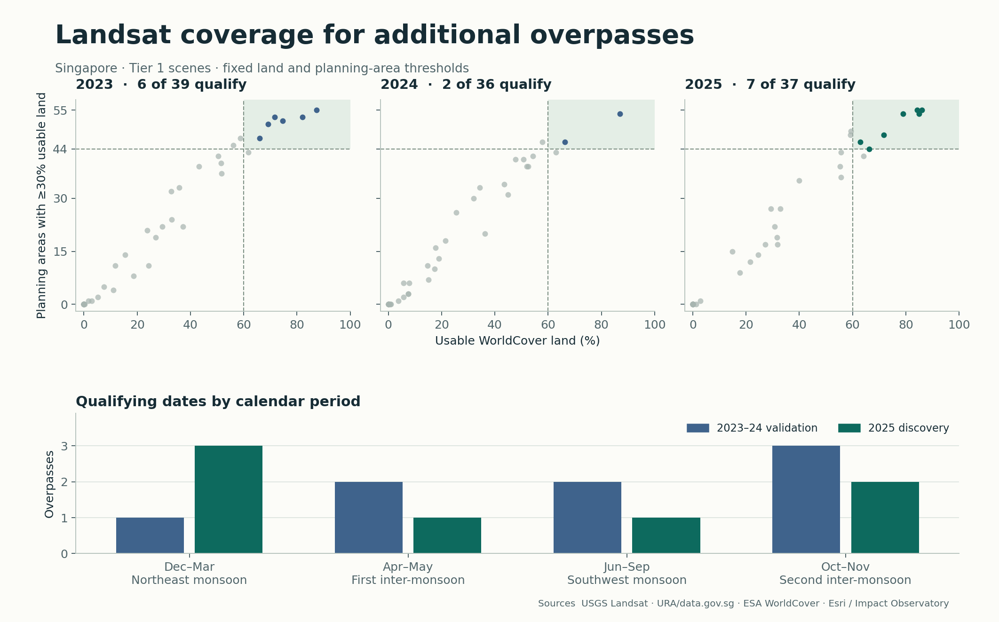
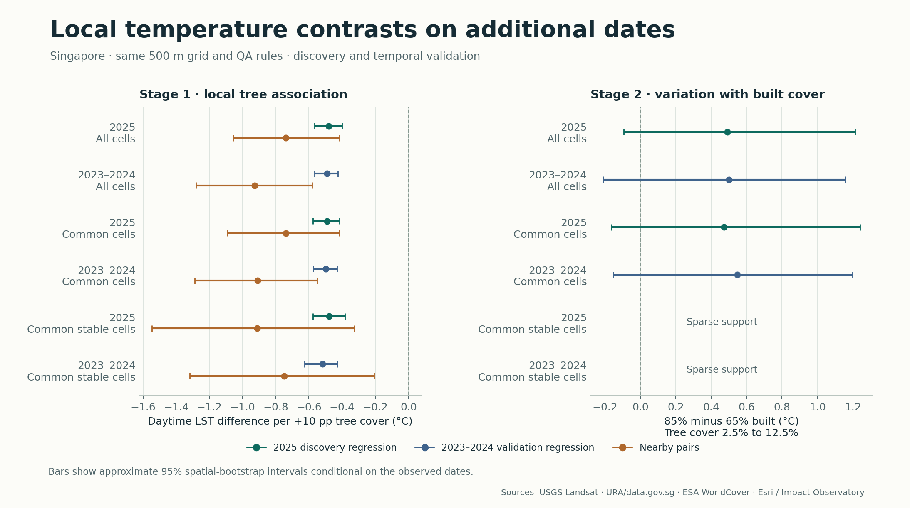

# Validation on additional Landsat overpasses in Singapore

Across eight held-out overpasses in 2023–24, ten percentage points more tree cover was associated with **0.49 °C lower daytime land surface temperature** within a date and 4 km area. The 2025 estimate was **0.48 °C lower**. The built-cover comparison again depended on geographic support. It gave a positive point difference on the pooled sample and a negative one in block-dates that supported both built bands, with intervals spanning zero.

## Candidate scenes and temporal coverage

The audit reproduced the 2025 Tier 1 scene screen. Of the 30 Tier 1 scenes outside the seven discovery dates, zero reached both coverage thresholds and 19 still contained at least one disjoint nearby pair. The highest land coverage among those 30 scenes was **64.08% on 30 July 2025**, when **42 of 55** planning areas reached 30% usable coverage. On 11 May, 49 planning areas passed but land coverage was 59.28%. The required levels were 60% of WorldCover land and 44 qualifying planning areas. [2025 scene ledger](../results/overpass_validation/audit/2025/scene_coverage.csv)

Under the same rules, 6 of 39 Tier 1 scenes from 2023 and 2 of 36 from 2024 qualified. Each analysis used that year's Esri cover classification on the original 500 m grid and fixed study domain. Coverage across the eight validation scenes ranged from **66.00% to 87.38%** of land, with 1,761–2,418 eligible grid cells per date. Acquisitions occurred between **11:15:55 and 11:16:48 a.m. Singapore time**. The scene list, coverage thresholds, sample construction, and comparisons were committed before aggregating the validation temperatures. [2023 ledger](../results/overpass_validation/audit/2023/scene_coverage.csv) · [2024 ledger](../results/overpass_validation/audit/2024/scene_coverage.csv) · [Frozen validation acquisitions](../results/overpass_validation/design/validation_scenes.csv) · [Protocol](OVERPASS_VALIDATION_PROTOCOL.md)

| Singapore calendar period | 2025 discovery dates | 2023–24 validation dates |
| --- | ---: | ---: |
| Northeast Monsoon, December–March | 3 | 1 |
| First inter-monsoon, April–May | 1 | 2 |
| Southwest Monsoon, June–September | 1 | 2 |
| Second inter-monsoon, October–November | 2 | 3 |

The date groups use calendar months. The Meteorological Service Singapore confirmed Northeast Monsoon conditions during the first half of March 2024, which includes the sole Northeast Monsoon validation date, 13 March. Date-specific estimates therefore give a clearer view of variation than a single estimate labeled by season. [Climate period definitions](https://www.weather.gov.sg/learn_winds/) · [March 2024 weather review](https://www.weather.gov.sg/fwo-dry-and-warm-conditions-to-continue-in-the-coming-days-more-thundery-showers-expected-in-the-last-week-of-march-2024/)

## Common geography and annual cover

There were **2,442 common cells** with at least one usable observation in each of 2023, 2024, and 2025. Of these, **1,701** had ranges of at most five percentage points across the three annual maps in each of tree, built and water share. This definition keeps the geographic cell IDs fixed across cohorts while retaining year-specific cover fractions and actual date availability. The map shows where coverage and annual classifications supplied those comparisons. [Support table](../results/overpass_validation/design/sample_support.csv) · [Annual shares by cell](../results/overpass_validation/design/annual_cover_comparison.csv) · [Common geography map](../results/overpass_validation/figures/common_geography.png)

Across common cells, an Esri water-share range above five points occurred in 32 of 351 cells with less than 90% land in the fixed study domain and in 28 of 2,091 cells with more complete land coverage. Large built-cover ranges clustered in the northwest and east. These checks locate where potential land-cover changes and differences in annual class assignment could influence the comparisons. [Cover stability counts](../results/overpass_validation/analysis/cover_stability.csv)

## Stage 1 local tree-cover association

The model uses separate intercepts for each date and 4 km block, with adjustments for built share, its squared term, and land share. It gives dates equal total weight. The 2023–24 full regression used 16,337 cell-dates from 2,491 distinct cells after dropping single-cell block-dates. The pairing check used 467 same-date nearby pairs under the Stage 1 distance and cover rules. The table gives each difference in °C per ten percentage points more tree cover, with approximate 95% spatial-bootstrap intervals in brackets. [Stage 1 methods](LOCAL_COMPARISON_PROTOCOL.md) · [Estimates and draw counts](../results/overpass_validation/analysis/local_estimates.csv)

| Local comparison | 2025 discovery | 2023–24 validation |
| --- | ---: | ---: |
| Full regression | −0.48 [−0.57, −0.40] | **−0.49 [−0.57, −0.43]** |
| Regression on common cells | −0.49 [−0.58, −0.42] | −0.50 [−0.57, −0.43] |
| Regression on common stable cells | −0.48 [−0.58, −0.38] | −0.52 [−0.63, −0.43] |
| Full nearby-pair estimate | −0.74 [−1.06, −0.42] | −0.93 [−1.28, −0.58] |

The validation regression estimates ranged from **−0.69 to −0.31 °C** across the eight dates. Each date's regression and nearby-pair interval lay below zero. The period means of the regression point estimates ranged from −0.59 to −0.39 °C, with one to three dates per period. The equal-period average was −0.48 °C in each cohort at two decimal places. Those summaries describe variation over the observed dates. The spatial intervals condition on those dates. [Overpass estimates](../results/overpass_validation/analysis/date_estimates.csv) · [Period table](../results/overpass_validation/analysis/period_estimates.csv) · [Equal-period summaries](../results/overpass_validation/analysis/equal_period_estimates.csv)

## Stage 2 variation with built cover

With the tree endpoints held at 2.5% and 12.5%, the estimated validation contrasts were **−1.51 °C** [−2.16, −0.80] at 65% built and **−1.01 °C** [−1.39, −0.62] at 85%. This fit used 1,677 cell-dates from 347 cells. There were 11 spatial blocks supporting the lower built band and 34 supporting the higher band across eight dates. Subtracting the 65% contrast from the 85% contrast gives **+0.50 °C** [−0.21, +1.16]. The 2025 difference was +0.49 °C [−0.09, +1.21]. The two contrasts are evaluated within the same bootstrap draws, with 1,903 of 1,999 draws retained for the main validation estimate. [Built-cover estimates](../results/overpass_validation/analysis/built_cover_estimates.csv)

Restricting to the cells observed in all three years gave a validation difference of +0.55 °C [−0.15, +1.20]. The flexible piecewise specification in the full sample gave +0.37 °C [−0.98, +0.85]. For the exact same block-dates in both built bands, the validation difference was **−0.18 °C** [−0.43, +0.37] from 210 observations in seven spatial blocks. That smaller fit retained 1,302 of 1,999 resamples, so its interval describes a narrower set of supported draws. The corresponding 2025 same-block-date point estimate was −0.30 °C. All eight validation dates had spatial intervals spanning zero for the built-cover difference. [Overpass figure](../results/overpass_validation/figures/by_overpass.png) · [Stage 2 results](BUILT_COVER_RESULTS.md)

The further restriction to stable cover removed the comparison at 65% built in all three years. Among common cells in the tight neighborhood of 65% built and 12.5% tree cover, there were 5 such cells in 2023, 10 in 2024, and 7 in 2025 before applying the stability rule. Each exceeded the five-point range in at least one class, including frequent shifts in built share. The 85% band retained eligible endpoints. Restricting geography and cover this way therefore leaves support for only one arm of the built comparison. [Annual shares by cell](../results/overpass_validation/design/annual_cover_comparison.csv) · [Endpoint support](../results/overpass_validation/design/sample_support.csv)

The validation strengthens the evidence for a negative local association during sampled clear-sky daytime overpasses. The direction of its variation by built cover remains sensitive to which local areas support both comparisons. Tree share is measured at fixed built share, so higher tree cover corresponds to lower shares of other land-cover classes. The analysis describes contrasts among observed surfaces on the selected dates, with sparse weather-period replication. [Reproduction commands](REPRODUCE.md#stage-3-validation-on-additional-overpasses)

The laboratory rerun from the frozen manifests and cached source windows reproduced the audits, panels, tables and figures byte for byte. An independent weighted regression with explicit block-date intercepts reproduced both primary validation estimates.
