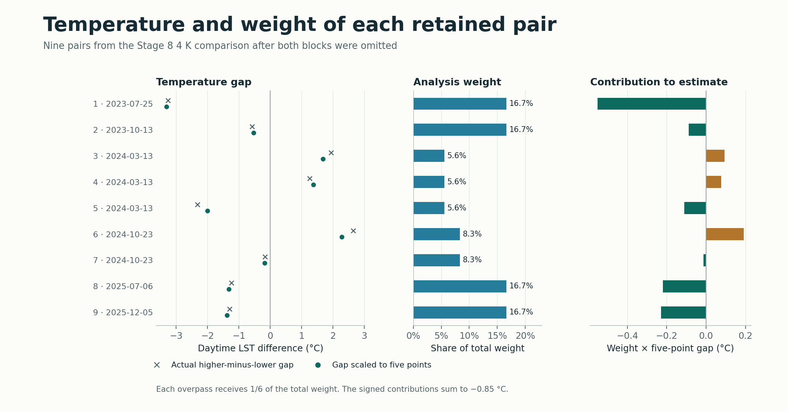
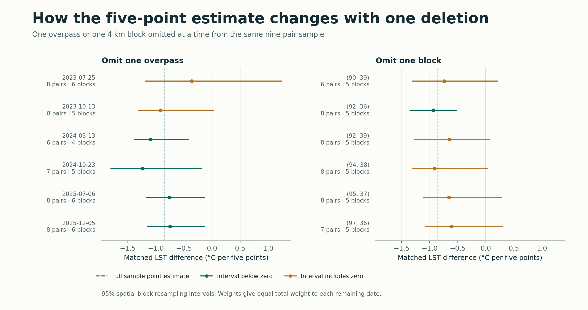

# Stage 9 influence of individual dates and blocks

The Stage 8 result for the nine common 4 K observations was **−0.85 °C per five points** [−1.21, −0.18]. Every one of the 12 deletion estimates remained negative. The magnitudes varied from **−1.23 to −0.36 °C** across date omissions and from **−0.94 to −0.61 °C** across block omissions. Two of six date-deletion intervals and five of six block-deletion intervals included zero. [Full deletion table](../results/quality_dense_influence/analysis/leave_one_out.csv)

## Pair temperatures and weights

Keep the Stage 8 endpoint temperatures under the 4 K, 0.5 km cloud-distance, and 60% per-endpoint land coverage conditions. Each of the six overpasses receives one sixth of total weight. If an overpass contributes multiple pairs, divide that weight equally among them. The temperature gap is higher-tree minus lower-tree LST. The five-point contrast is that gap multiplied by five divided by the observed tree-cover gap in percentage points. Multiply by the weight to obtain each pair's signed contribution. [Frozen cells, temperatures and weights](../results/quality_dense_influence/design/weighted_pairs.csv)

| Pair | Overpass | UTM block | Actual gap (°C) | Per five points (°C) | Weight | Contribution (°C) |
| ---: | --- | --- | ---: | ---: | ---: | ---: |
| 1 | 2023-07-25 | (90, 39) | −3.26 | −3.31 | 16.7% | −0.551 |
| 2 | 2023-10-13 | (94, 38) | −0.57 | −0.53 | 16.7% | −0.088 |
| 3 | 2024-03-13 | (90, 39) | +1.95 | +1.68 | 5.6% | +0.093 |
| 4 | 2024-03-13 | (92, 36) | +1.26 | +1.38 | 5.6% | +0.077 |
| 5 | 2024-03-13 | (95, 37) | −2.31 | −2.01 | 5.6% | −0.111 |
| 6 | 2024-10-23 | (90, 39) | +2.65 | +2.29 | 8.3% | +0.191 |
| 7 | 2024-10-23 | (92, 39) | −0.17 | −0.17 | 8.3% | −0.014 |
| 8 | 2025-07-06 | (97, 36) | −1.23 | −1.31 | 16.7% | −0.219 |
| 9 | 2025-12-05 | (97, 36) | −1.29 | −1.37 | 16.7% | −0.229 |

Pair 1 contributes the most negative term, **−0.55 °C**, with one sixth of total weight. Block (97, 36) has the largest original weight, **33.3%**. It contains the same ordered spatial pair on two 2025 overpasses and contributes **−0.45 °C**. Block (90, 39) has **30.6%** of the weight, with one cooler and two warmer higher-tree observations. Its net contribution is **−0.27 °C**. The signed contributions characterize the full sample. Each omission below recalculates weights among the remaining dates and pairs.

## Omit one date or one block

Start each of the 12 runs from all nine observations. Delete the indicated date or block, then give each remaining overpass equal total weight. Draw whole retained 4 km blocks 1,999 times with replacement using the Stage 8 method, with the within-run observation weights held fixed. All runs meet the Stage 6 date and block criteria for the matched contrast. [Locked method](QUALITY_DENSE_INFLUENCE_PROTOCOL.md) · [Omitted pair IDs and remaining support](../results/quality_dense_influence/analysis/leave_one_out.csv)

| Omitted overpass | Remaining pairs | Remaining blocks | Contrast (°C) | 95% interval (°C) | Shift from full sample (°C) |
| --- | ---: | ---: | ---: | ---: | ---: |
| 2023-07-25 | 8 | 6 | −0.36 | [−1.19, +1.25] | +0.49 |
| 2023-10-13 | 8 | 5 | −0.92 | [−1.32, +0.04] | −0.06 |
| 2024-03-13 | 6 | 4 | −1.09 | [−1.39, −0.41] | −0.24 |
| 2024-10-23 | 7 | 5 | −1.23 | [−1.81, −0.18] | −0.38 |
| 2025-07-06 | 8 | 6 | −0.76 | [−1.17, −0.12] | +0.09 |
| 2025-12-05 | 8 | 6 | −0.75 | [−1.16, −0.12] | +0.10 |

| Omitted block | Remaining pairs | Remaining dates | Contrast (°C) | 95% interval (°C) | Shift from full sample (°C) |
| --- | ---: | ---: | ---: | ---: | ---: |
| (90, 39) | 6 | 5 | −0.74 | [−1.32, +0.22] | +0.11 |
| (92, 36) | 8 | 6 | −0.94 | [−1.36, −0.51] | −0.09 |
| (92, 39) | 8 | 6 | −0.65 | [−1.28, +0.08] | +0.20 |
| (94, 38) | 8 | 5 | −0.92 | [−1.32, +0.04] | −0.06 |
| (95, 37) | 8 | 6 | −0.66 | [−1.11, +0.29] | +0.20 |
| (97, 36) | 7 | 4 | −0.61 | [−1.08, +0.31] | +0.25 |

Omitting 25 July 2023 produces the largest point shift, from −0.85 to **−0.36 °C**. Omitting 23 October 2024 removes two observations whose net contribution was positive and gives the strongest negative point estimate, **−1.23 °C**. Omitting block (97, 36) gives the largest block shift. The 13 October 2023 deletion and the (94, 38) deletion remove the same record.

The local association has a negative point estimate in every run. Its magnitude and the evidence for an interval entirely below zero depend on which of the few available dates and blocks are represented. These spatial intervals describe the selected overpasses and retained comparisons. [Stage 8 support](QUALITY_DENSE_SWAP_RESULTS.md) · [MacKinnon, Nielsen, and Webb on cluster influence](https://doi.org/10.1016/j.jeconom.2022.04.001)

## Reproduction

The original pair ledger was committed at `a1c6537` before the deletion fits. Replaying the full sample reproduced its Stage 8 point estimate and interval. The published tables preserve each removed group, observation count, point shift, and interval. [Reproduction commands](REPRODUCE.md#stage-9-influence-on-the-4-k-result)
