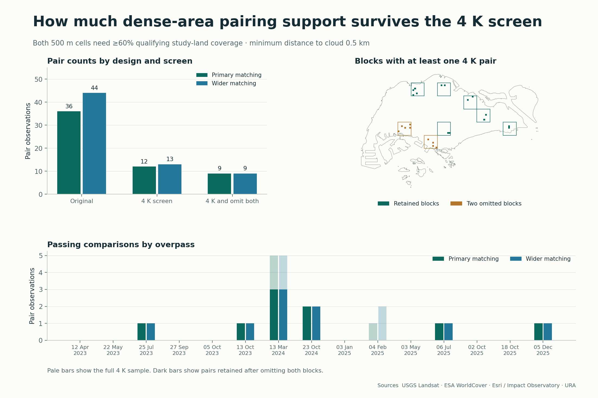
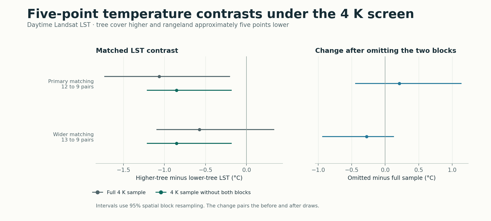

# Stage 8 daytime LST after the 4 K quality screen

Applying the specified Landsat quality screen to all dense-area pairs left **12 of 36** primary observations and **13 of 44** wider observations. Both samples represented eight geographic blocks. Simultaneously omitting the two blocks from Stage 7 left the **same nine pair-date records** under each rule. Their matched five-point association was **−0.85 °C** with a 95% spatial resampling interval of **−1.21 to −0.18 °C**. These comparisons use daytime surface temperatures on the dates, cells and pixel footprints that retain qualifying coverage. [Support and IDs](../results/quality_dense_swap/design/pair_coverage.csv) · [Temperature estimates](../results/quality_dense_swap/analysis/estimates.csv)

## Which observations survive the screen

The starting lists cover high-built cells with at least 80% built cover at both endpoints. The lists share 35 of their original pair-date observations. Their union has 45 observations and 89 distinct cell-date endpoints. Apply the Stage 7 screen for reported pixel uncertainty of at most 4 K and distance to mapped cloud of at least 0.5 km, with at least 60% coverage of study land at each endpoint. Calculate endpoint temperature from the qualifying pixels only. The original fill, cloud, shadow and plausible-temperature rules still apply. [Frozen protocol](QUALITY_DENSE_SWAP_PROTOCOL.md) · [Landsat Level 2 product guide](https://www.usgs.gov/media/files/landsat-8-9-collection-2-level-2-science-product-guide)

| Frozen rule and sample | Pair observations | Distinct spatial pairs | Overpasses | 4 km blocks |
| --- | ---: | ---: | ---: | ---: |
| Primary · original | 36 | 12 | 14 | 9 |
| Primary · 4 K | 12 | 10 | 7 | 8 |
| Wider · original | 44 | 14 | 15 | 9 |
| Wider · 4 K | 13 | 11 | 7 | 8 |
| Either rule · 4 K and omit both blocks | 9 | 7 | 6 | 6 |

Eleven passing observations are shared, one is unique to the primary rule, and two are unique to wider matching. The latter two are the Jurong East and Bukit Merah records identified in Stage 7. Both are in the two omitted blocks. At least one endpoint falls short of the required coverage in 24 primary and 31 wider observations. Both endpoints fall short in 13 and 17 observations, respectively. [Endpoint coverage](../results/quality_dense_swap/design/endpoint_coverage.csv) · [Per-date counts](../results/quality_dense_swap/design/support_by_date.csv)

## Temperature before and after block omission

Subtract the lower-tree endpoint temperature from the higher-tree endpoint temperature, using qualifying pixels for each mean. Scale the difference by five divided by the observed tree gain in percentage points. Give each overpass equal total weight. Both the full and reduced samples pass the Stage 6 support criteria for matched contrasts. The reduced sample covers two dates in 2023, two in 2024 and two in 2025. With equal weight by date, its mean cover gaps are +5.07 points of trees and −5.23 points of rangeland. The mean absolute built-cover gap is 0.43 point. [Paired temperatures and realized cover gaps](../results/quality_dense_swap/analysis/qa4_paired_temperatures.csv)

| Frozen rule | Full 4 K sample (°C) | 95% interval | Both blocks omitted (°C) | 95% interval | Change (°C) | 95% interval for change |
| --- | ---: | ---: | ---: | ---: | ---: | ---: |
| Primary | −1.06 | [−1.73, −0.20] | −0.85 | [−1.21, −0.18] | +0.21 | [−0.45, +1.14] |
| Wider | −0.57 | [−1.10, +0.34] | −0.85 | [−1.21, −0.18] | −0.28 | [−0.94, +0.13] |

The change intervals apply common 4 km block multiplicities to both samples. Keeping the original date weights in the reduced sample gives −0.94 °C under each rule. The intervals for both changes include zero. [Paired omission changes](../results/quality_dense_swap/analysis/omission_changes.csv)

The full wider sample meets the Stage 6 residual adjustment checks and estimates **−0.61 °C** [−2.47, +0.72]. The full primary comparison has 1,777 full-rank draws out of 1,999. The common omitted sample has 1,658. These two counts fall below the original 95% requirement, so the before-and-after comparison reports the matched estimate. In the reduced sample the highest-weight block supplies one third of the total weight. The interval describes selected local comparisons observed on six overpasses. [Frozen rank and support record](../results/quality_dense_swap/design/design_record.json) · [Estimates and fit status](../results/quality_dense_swap/analysis/estimates.csv)

## Reproduction

At commit `8ce178d` the coverage counts and rank checks were frozen before fitting the 4 K temperatures. Native Landsat windows independently reproduced all 89 endpoint coverage records and the means of qualifying temperatures for 41 endpoints meeting the 60% threshold. The published data retain the original pair IDs, coverage counts, and all temperatures used in the matched results. [Reproduction commands](REPRODUCE.md#stage-8-four-kelvin-quality-screen-in-dense-built-areas)
