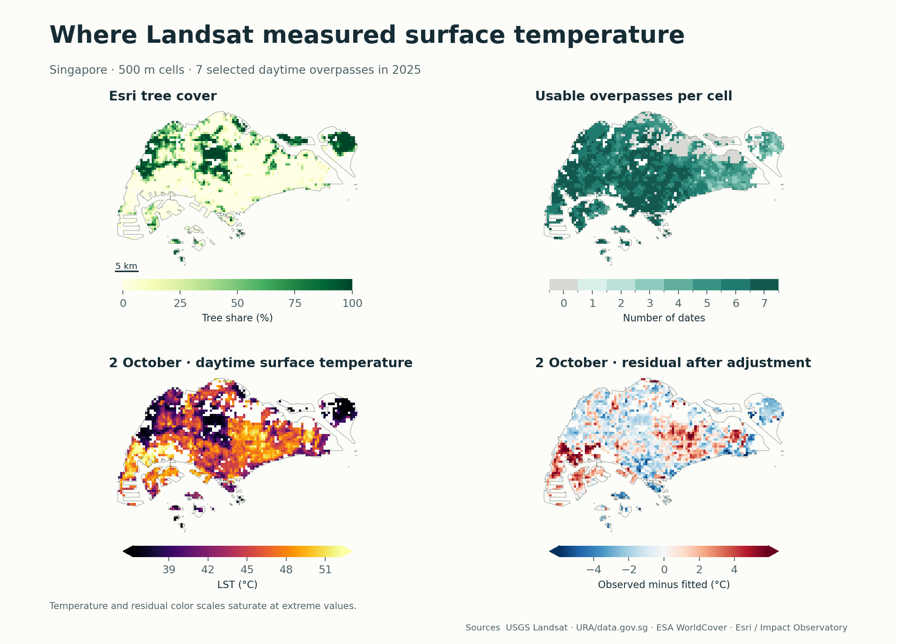
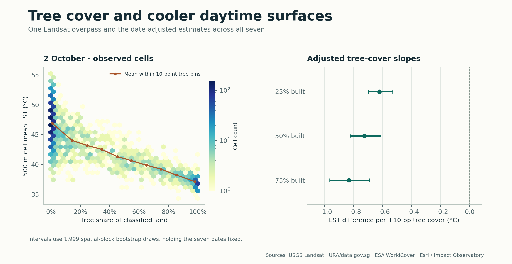
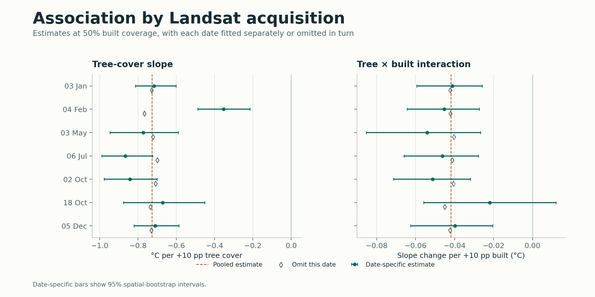

# Tree cover and daytime land surface temperature in Singapore

## Research question

Across areas of Singapore observed on seven Landsat daytime overpasses in 2025, how did land surface temperature (LST) vary with the share of land classified as trees? Did this relationship vary across levels of built-area cover?

Land use, local morphology and vegetation vary sharply over short distances in Singapore. Earlier local work has examined how land use relates to temperature differences across the city. This project uses satellite-retrieved surface temperatures to quantify an association within selected overpasses and evaluate how much the result depends on spatial sampling and model choice. [Jusuf et al., 2007](https://www.sciencedirect.com/science/article/abs/pii/S0197397507000148)

## Data feasibility and scope

The intended annual MODIS study required 24 valid days in 9 or more months, at least 2 days in each quarter, and 80% of land covered by cells meeting the time rules. The 2025 MOD11A1.061 archive indexed 365 days. The public mirror provided 209 pairs of daytime LST and quality bands. The remaining dates could only raise qualifying coverage to 7.70%, even if every missing date qualified everywhere. The second quarter alone had all 91 input days and only 8.88% of land with at least two accepted days. The Esri 2025 class audit corrected the prior cloud coding and found that 99.979% of non-water centers within URA had a valid class. [Feasibility results](FEASIBILITY.md)

In the Landsat screen, seven of 44 scenes met the per-scene temperature and geographic rules and belonged to Tier 1. Raw per-scene QA and range coverage extended from about 63% to 86% of WorldCover land. On native Landsat pixel footprints, the seven scenes had a 90.08% geographic union, and 34.35% of land passed on all seven dates before gridding. The old Landsat annual union was 89.985% with the prior implementation, near its 90% threshold. The analysis scope chosen after feasibility is the seven selected dates. They occurred across the year and were selected for satellite quality and coverage. [Scene and repeat coverage](../results/landsat_screening/repeat_coverage.csv) · [Data sources](DATA_SOURCES.md)

## Methods

### Spatial aggregation

Use the 55 planning areas in the URA Master Plan 2025 (No Sea) and a fixed 500 m UTM 48N grid. ESA WorldCover 2021 defines non-water land for the main analysis. Map the class and temperature at each 10 m land center to its enclosing square. Use Esri 2025 tree and built-area classes as fractions of classified non-water land. Water, clouds and unclassified Esri pixels do not contribute to the classified land count. Restrict analysis to squares with at least half their area mapped as study land and at least 80% of that land classified in Esri.

Landsat 8/9 Collection 2 L2SP provides the surface-temperature band on a 30 m delivery grid. The original thermal measurement is coarser than that delivery grid. A candidate land center uses the QA and ST_B10 from its enclosing delivery pixel. Conversion to Celsius uses the USGS scale and offset. Require nonzero ST_B10, no fill, dilated cloud, cirrus, cloud, cloud shadow or snow flag in QA_PIXEL, and 15–70 °C. Average the accepted temperatures by square and date. Retain a square-date if at least 60% of its candidate land has accepted temperature. The regression unit is one square-date mean. The 10 m centers weight areas during aggregation. [USGS surface-temperature guide](https://www.usgs.gov/landsat-missions/landsat-collection-2-surface-temperature) · [Analysis plan](LANDSAT_ANALYSIS_PLAN.md)

### Association and uncertainty

Let `Y_it` be mean LST for grid cell `i` on date `t`. Define `T_i` in units of 10 percentage points of tree cover and `B_i` in units of 10 percentage points of built-area cover centered at 50%. The model is

```text
Y_it = date_intercept_t + b_tree T_i + b_built B_i
       + b_interaction T_i B_i + b_land land_share_i + error_it
```

OLS gives equal weight to each retained cell-date. Date intercepts remove differences in the fitted average temperature between the seven dates. At a fixed built fraction, an increase in tree fraction implies a decrease in the combined share of other classified types, whose composition varies across cells. The tree slope at a given built level is `b_tree + b_interaction B_i`. The interaction coefficient is the change in this slope for another 10 percentage points of built area. The model estimates differences among cells on each date.

The 95% percentile intervals come from 1,999 resamples of 78 occupied, nonoverlapping 4 km square blocks. Each draw keeps all cell-date records in a sampled block together and refits the date effects. This accounts approximately for dependence among nearby observations and repeated observations within cells. Alternative two- and six-kilometer layouts and a shifted four-kilometer grid check sensitivity to the partition. The dates are fixed in these intervals. We use Moran's I with binary queen-neighbor weights as a descriptive residual spatial check. [Lahiri and Zhu, 2006](https://doi.org/10.1214/009053606000000551) · [Moran, 1950](https://doi.org/10.1093/biomet/37.1-2.17)

## Results

### Coverage and sample composition

The primary sample has **14,678 cell-dates and 2,491 distinct cells**. Of 2,788 spatially eligible cells, 297 had no accepted date and 899 were observed on all seven dates. The observed cells contain 593.38 km² of the study mask, or 84.51% of the candidate land. That extent includes the full candidate land of each retained cell. Per-date QA coverage is measured separately. The scenes were all acquired between 11:16:21 and 11:16:54 Singapore time.

| 2025 acquisition | Usable 500 m cells | Mean LST of usable cells |
| --- | ---: | ---: |
| 3 January | 2,312 | 41.01 °C |
| 4 February | 1,833 | 31.13 °C |
| 3 May | 1,695 | 35.03 °C |
| 6 July | 2,159 | 39.82 °C |
| 2 October | 2,365 | 44.34 °C |
| 18 October | 1,977 | 41.65 °C |
| 5 December | 2,337 | 41.38 °C |

Never-observed eligible cells averaged 31.4% tree and 57.6% built area. Cells observed on one to six dates averaged 22.0% tree and 67.3% built area. Cells with all seven dates averaged 25.6% tree and 68.4% built area. Among eligible cells with 75–100% tree cover, 84.1% appeared on at least one date, versus 90.5% among cells below 25% tree cover. Cloud-related omission and fixed retrieval gaps can therefore change the spatial mix seen by the model. In retained cell-dates, the mean absolute difference between observed-footprint and whole-cell tree shares was below 0.4 percentage points on every date. [Coverage by land cover](../results/landsat_analysis/availability_by_cover.csv) · [Date diagnostics](../results/landsat_analysis/date_diagnostics.csv)



### Tree cover and surface temperature

| Built area | LST difference per +10 percentage points of tree cover | Approx. 95% interval | Cells within ±10 points of built reference |
| ---: | ---: | ---: | ---: |
| 25% | −0.62 °C | [−0.70, −0.53] °C | 168 |
| 50% | −0.73 °C | [−0.82, −0.61] °C | 194 |
| 75% | −0.83 °C | [−0.96, −0.69] °C | 252 |

The linear model estimates a slope change of **−0.042 °C** for each additional 10 percentage points of built cover (95% interval **[−0.060, −0.026]**). In the data, tree and built fractions have a cell-level Pearson correlation of −0.85. Near 75% built cover, the 10th–90th percentile range of tree cover is 0–27%. Near 25% built cover it is about 4–79%. Interpret the slope at each built level within the corresponding observed range. The additive model gives a common slope of −0.56 °C per 10 points of tree cover. The date-adjusted tree-only slope is −0.87 °C. [Model estimates](../results/landsat_analysis/estimates.json) · [Composition support](../results/landsat_analysis/composition_support.csv)



### Stability and model diagnostics

The within-date fit explains 62.8% of the centered LST variance in the same sample. The residual RMSE is 2.39 °C. Across the seven scenes, residual Moran's I ranges from 0.56 to 0.75, showing that strongly clustered temperature differences remain after adjustment. These values motivate the block resampling and an additional fit with 4 km block intercepts. The latter gives a tree slope of −0.64 °C at 50% built area.

The tree slope at 50% built area is negative on every date, ranging from −0.35 to −0.87 °C per 10 points of tree cover. Omitting any one date keeps the pooled slope between −0.77 and −0.70 °C and the linear interaction between −0.045 and −0.040 °C. The interaction interval for 18 October alone includes zero.

The tree association stays negative with a 1 km grid, shifted 500 m grid, Esri water mask, stricter land-share and QA-area rules, equal weights per cell, or only cells seen on all seven dates. The planned 2 K product-uncertainty check at least 0.5 km from clouds yielded zero usable records. An exploratory 4 K check retained 6,079 cell-dates. On that common sample, the strict and original temperature aggregates give nearly the same slopes (−0.834 and −0.835 °C). Most of the difference from the primary estimate follows from the different set of cell-dates.

The exploratory quadratic model allows separate curvature in tree and built fractions. At 10% trees and 50% built area, its local tree slope is **−0.80 °C** (95% interval **[−0.96, −0.63]**). Its interaction is **−0.028 °C** with a wider interval of **[−0.072, +0.013]**. Thus the negative tree association persists, with weaker evidence that its magnitude increases with built cover once the model admits curvature. Trimming date-specific temperature extremes leaves the linear estimates close to the main fit. [Sensitivity results](../results/landsat_analysis/robustness.csv) · [Date estimates](../results/landsat_analysis/date_estimates.csv)



## Limitations and conclusion

Across these seven overpasses, areas with more tree cover generally had cooler daytime surfaces after adjustment for date, built cover and cell land share. At a 50% built share the estimated difference was roughly three quarters of a degree Celsius per 10 percentage points of tree cover. A negative linear interaction is visible, with evidence about its magnitude and sign sensitive to how the land-cover relationship is modeled.

Land cover and local temperature may both reflect urban morphology, land use, coastlines, water, terrain and other spatially structured factors the model does not measure. The classification and temperature retrieval each have measurement error. The 2021 water mask predates the 2025 temperature and Esri data. The reported intervals use a spatial sampling approximation and condition on seven deliberately selected overpasses. The estimated differences should be read as clear-sky daytime surface associations on the sampled dates. The study cannot identify how planting trees would change temperature, assess annual or nighttime conditions, or predict individual heat exposure.
